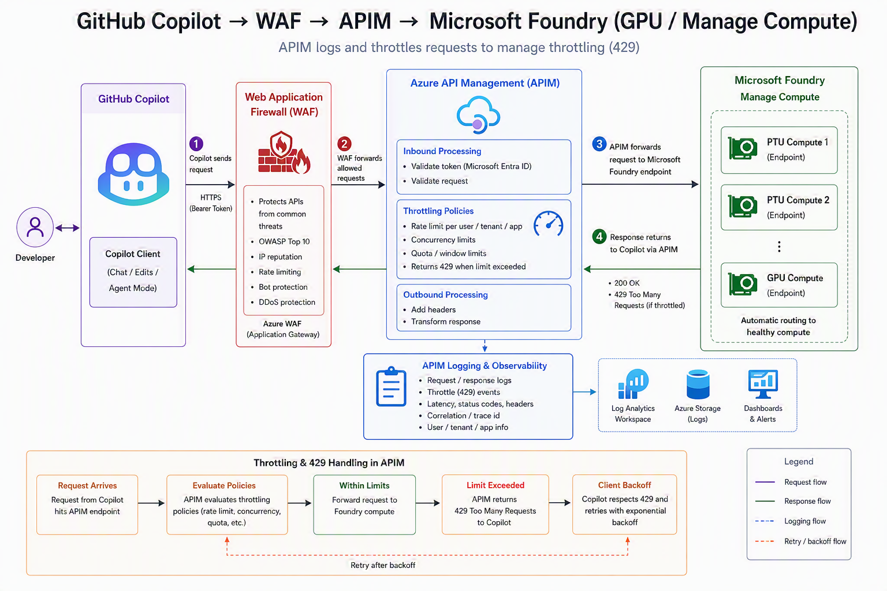
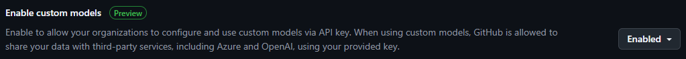
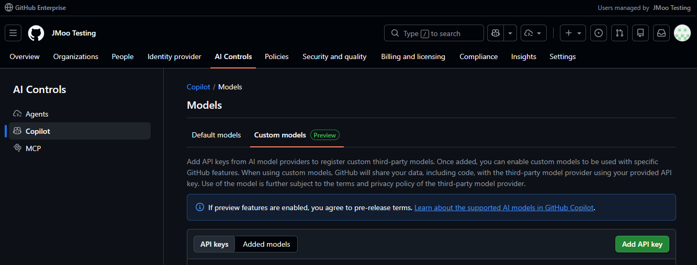
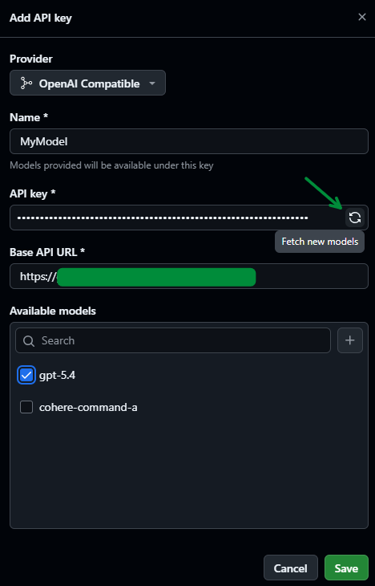
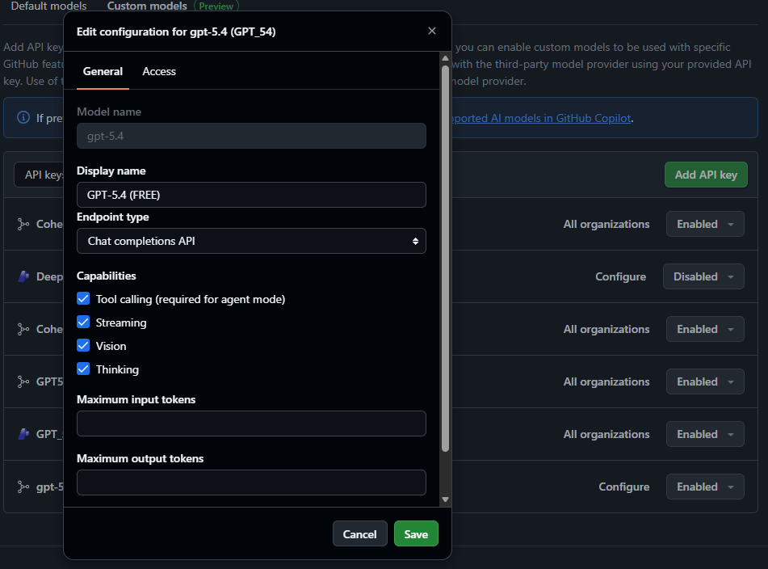
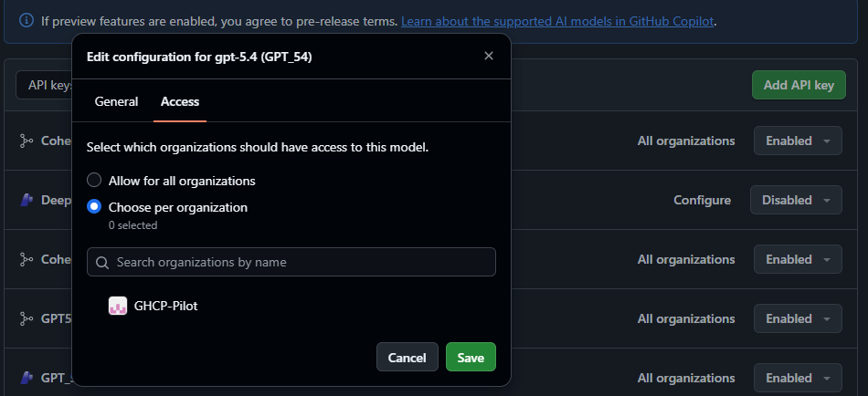

# GitHub Copilot BYOK with APIM

Use your Microsoft Foundry models in GitHub Copilot with bring your own key (BYOK). This reference
implementation uses Application Gateway and Azure API Management (APIM) to manage access,
routing, and limits for multiple GitHub organizations on one shared gateway.

## Contents

- [How it works](#how-it-works)
- [Supported clients](#supported-clients)
- [Get started](#get-started)
- [Configure enterprise BYOK](#configure-enterprise-byok)
- [Documentation](#documentation)
- [Further reading](#further-reading)

## How it works

Each organization gets its own `/byok/<org>` endpoint, API key, and policy:

1. **Application Gateway** terminates TLS, inspects requests with its web application firewall
   (WAF), and adds a shared gateway-secret header.
2. **APIM** checks the gateway secret and organization key, applies per-org request limits and
   any model allowlist, then routes the request.
3. **Foundry** receives the request authenticated with APIM's managed identity. Clients never
   need a Foundry key.

The URL path selects the organization; the matching key authorizes access. Changing the path
without that organization's key does not grant access.

Two defaults matter:

- **APIM remains public.** Its gateway-secret policy rejects direct requests without the correct
  secret; this is not network isolation.
- **WAF starts in Detection mode.** It records rule matches but does not block requests. Review
  coding traffic and tune false positives before enabling Prevention mode.

Token limits, token metrics, content safety, semantic caching, and a resilient multi-Foundry
backend pool are optional. See the [AI Gateway guide](docs/ai-gateway.md) to enable them.

## Supported clients

| Client | Configuration |
| --- | --- |
| VS Code | **Custom Endpoint**, with Chat Completions or Responses as supported by the model |
| Copilot CLI | `COPILOT_PROVIDER_TYPE=openai`, not `azure` |
| GitHub.com, CLI, and IDEs (enterprise BYOK) | **OpenAI-compatible provider**, scoped per organization |

For all clients, use:

- **Base URL:** `https://<gateway-host>/byok/<org>` using your gateway's HTTPS hostname, not the
  APIM hostname.
- **API key:** the matching organization's key from `orgKeys`, not an APIM subscription key or
  Foundry key.
- **Model:** your Foundry deployment name.

The proxy supports `/chat/completions`, `/responses`, and `/models` under each organization path.
Model discovery lists deployed models, filtered by any configured `orgModels` allowlist.
See [client configuration](docs/client-surfaces.md) for per-client steps.

**Scope:** Access, attribution, and limits are per organization, not per user or team. APIM does
not authenticate individual users with Entra ID. BYOK covers chat and agent tasks; inline code
completions still use GitHub-hosted models.

## Get started

1. **Prepare a model.** Use an existing Foundry account with a deployment that meets the
   [model requirements](#model-requirements) below.
2. **Deploy the gateway.** Follow [Getting started](docs/getting-started.md) for prerequisites,
   per-org keys, Bicep parameters, and verification. Enable `deployAppGateway` and
   `appGwEnableHttps` for the HTTPS gateway path described here; both default to `false`.
   [Configure DNS and a TLS certificate](docs/getting-started.md#production-enable-https-on-the-app-gateway)
   before connecting Copilot.
3. **Connect Copilot.** Follow [client configuration](docs/client-surfaces.md), or the
   enterprise setup below.

Keep organization keys, the gateway secret, and certificate data and passwords out of source
control.

### Model requirements

The Foundry deployment must support **tool calling** and **streaming**. A context window of
**at least 128k tokens** is recommended. Models without tool calling or streaming cause
Copilot CLI errors.

## Configure enterprise BYOK

An enterprise owner must first enable **AI controls > Copilot > Features > Enable custom models**.

> [!NOTE]
> Enterprise BYOK is in public preview and subject to change.

Repeat the following steps for each organization, using its endpoint and key.

### Add API keys

1. Open your enterprise from the GitHub profile menu. Go to **AI controls > Copilot >
   Configure allowed models > Custom models**.

   

2. Select **Add API key** and complete the form:

   | Field | Value |
   | --- | --- |
   | **Provider** | **OpenAI Compatible** |
   | **Name** | A recognizable name for the organization's key |
   | **API key** | The organization's key from `orgKeys` |
   | **Base API URL** | `https://<gateway-host>/byok/<org>` |
   | **Available models** | Select **Fetch new models**, then choose the models to expose |

   

3. Select **Save**.

### Configure added models

1. On the **General** tab, select **Configure** next to the added key. Set the model's display
   name, endpoint type, and capabilities.

   

2. On the **Access** tab, select **Choose per organization** and choose the matching organization.

   

3. Select **Save**. Models may take about five minutes to appear in the organization's picker.

For GitHub's instructions, see
[Enabling custom models](https://docs.github.com/en/enterprise-cloud@latest/copilot/how-tos/administer-copilot/manage-for-organization/enable-custom-models#adding-your-key-to-an-organization-account).

## Documentation

| Guide | Use it to |
| --- | --- |
| [Getting started](docs/getting-started.md) | Deploy and verify the gateway |
| [Traffic flow and WAF placement](docs/traffic-flow.md) | Follow a request and troubleshoot connection or authorization failures |
| [Client configuration](docs/client-surfaces.md) | Set up VS Code, Copilot CLI, or enterprise BYOK |
| [AI Gateway capabilities](docs/ai-gateway.md) | Enable token governance, metrics, content safety, caching, or backend resilience |
| [Reference architecture](docs/reference-architecture.md) | Understand the design, policies, and deployment parameters |

## Further reading

- [VS Code: Bring your own language model key](https://code.visualstudio.com/docs/agent-customization/language-models#_bring-your-own-language-model-key)
- [Copilot CLI: Use your own models](https://docs.github.com/en/copilot/how-tos/copilot-cli/customize-copilot/use-byok-models)
- [Enterprise: Use your LLM provider API keys](https://docs.github.com/en/copilot/how-tos/administer-copilot/manage-for-enterprise/use-your-own-api-keys)
- [Azure API Management AI gateway](https://learn.microsoft.com/en-us/azure/api-management/genai-gateway-capabilities)
- [Import a Microsoft Foundry API](https://learn.microsoft.com/en-us/azure/api-management/azure-ai-foundry-api)
- [Application Gateway WAF](https://learn.microsoft.com/en-us/azure/web-application-firewall/ag/ag-overview)

## Contributors

## Acknowledgements

Based on [ghcp-byok-apim](https://github.com/Frank802/ghcp-byok-apim) by **Frank802**.

## Code of conduct

This project has adopted the [Microsoft Open Source Code of Conduct](CODE_OF_CONDUCT.md).

## License

See the [MIT license](LICENSE.txt).
