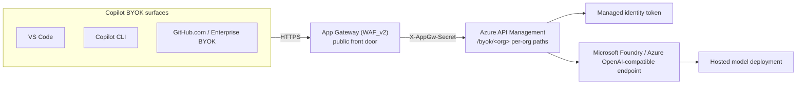
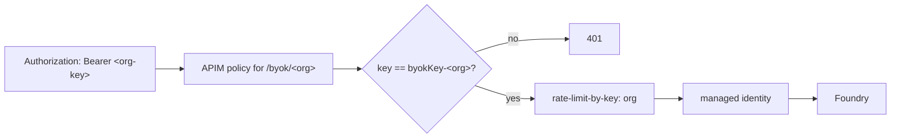
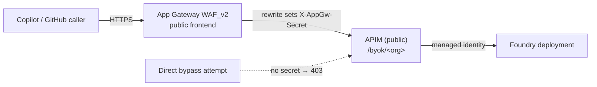
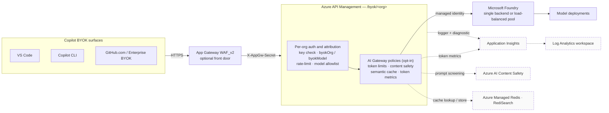

# Reference architecture

> New to the project? Start with the **[getting started guide](getting-started.md)** to
> deploy the gateway, then come back here for the design details.

For configuration defaults and dependencies, see the [parameter reference](parameters.md).



> This is the **baseline** flow. The optional AI Gateway capabilities — observability
> (Application Insights + Log Analytics), content safety, semantic caching, and the multi-Foundry
> pool — are shown in the [full architecture diagram](#full-architecture-baseline--opt-in) below.

## Intended scenario

This gateway is **multi-tenant by GitHub organization**. On one shared APIM instance it
publishes a **separate path, key, and policy per org** (`/byok/<org>`), fronted by an
**Application Gateway (WAF_v2)** that terminates TLS and blocks direct-to-APIM bypass. The
organization is the identity boundary: each org registers its own OpenAI-compatible provider
(scoped to that org in GitHub's AI controls) and its callers present that org's key, so you can
**attribute, throttle, and rotate credentials per organization** without standing up a gateway
per org.

The boundary is the **organization**, not the individual user or a sub-org team — per-user
identity is out of scope. The individual surfaces (VS Code, Copilot CLI) can point at the same
`/byok/<org>` paths for development and testing.

## Design

Every Copilot BYOK surface — VS Code, the Copilot CLI, or GitHub.com (enterprise BYOK) — talks
to the **App Gateway** over HTTPS, which forwards to **APIM** as an OpenAI Chat Completions
endpoint. For each request APIM:

- validates the caller against **that org's** key (the `/byok/<org>` path selects the policy)
- authenticates to the backend with **managed identity** (no backend keys in clients)
- routes to a named backend entity — `foundry-backend` by default, or a per-org override
  (Cohere / managed-compute)
- appends the required `api-version` and preserves the OpenAI-compatible payload shape

The Foundry resource is the model host. This keeps model access centralized, auditable, and easy
to swap without changing the client contract, while the per-org path/key/policy slice gives each
org an isolated, independently rotatable credential on shared infrastructure.

## Per-organization multi-tenant BYOK

The gateway is **multi-tenant by organization** (`infra/main.bicep`, with `orgs` inferred from
the `orgKeys` map unless overridden). It stamps out an independent slice per organization so you can
attribute, throttle, and rotate credentials **per org** on a single shared APIM instance —
no extra gateways. (A single-org deployment is just this with one entry in `orgs`.)

For each org slug in `orgs`, the template creates:

- an **API** published at `byok/<slug>` (the org identity *is* the URL path),
- a **secret named value** `byokKey-<slug>` holding that org's key,
- an **auth policy** specialised to that org — it validates the presented key against
  `{{byokKey-<slug>}}` only, tags the request with the org, and applies a per-org
  `rate-limit-by-key`.

An org can optionally be pinned to a **model allowlist** (`orgModels[<slug>]`). When set, that
org's `/models` is filtered to the listed ids and any chat/responses request naming another model
is rejected with **403** — so, for example, `team-alpha` sees and calls only `gpt-5.6-sol` while
`team-beta` is limited to `cohere-north-mini-code`. Orgs without an entry are unrestricted.



### Why the URL path is not a bypass

The path is only routing; the **per-path key is the credential**. Each org's policy
compares against *its own* `byokKey-<slug>` and nothing else. So a caller who repoints at
another org's `/byok/<other>` URL without that org's key gets a `401` — they cannot shift
cost onto another org by editing the URL. This key-to-path binding is why each org must get
a distinct key.

### GitHub-side scoping (this is what makes it enforceable)

GitHub's [enterprise BYOK](https://docs.github.com/en/copilot/how-tos/administer-copilot/manage-for-enterprise/use-your-own-api-keys)
model aligns with this design in two important ways:

1. **One key per deployment URL.** GitHub requires a separate API key entry per deployment
   URL, so registering `.../byok/<org>` as its own entry with its own key is the expected
   shape — a 1:1 URL↔key mapping.
2. **Per-organization availability.** Under **AI controls → Copilot → Configure allowed
   models → Custom models**, each model's **Access** tab offers **Allow for all
   organizations** or **Choose per organization**. Scope each org's registration to just
   that org so its members are the only ones who see (and can select) it. Because GitHub
   injects the key **server-side**, members can neither extract another org's key nor pick
   a model that wasn't scoped to them.

Register, per org: an OpenAI-compatible custom model with **Deployment URL**
`https://<gateway-host>/byok/<slug>`, that org's key, and **Access → Choose per
organization** limited to the matching org.

### Limitation: the boundary is the org, not the team

GitHub's scoping boundary is the **organization**. If your teams map 1:1 to GitHub orgs,
attribution is clean and fully enforced. If several teams share **one** org, GitHub cannot
sub-divide them — every member of that org sees that org's model, so you cannot separate
teams *within* an org through the enterprise picker. For sub-org separation, fall back to
the **individual** CLI/VS Code surfaces (where each user sets their own key) or accept
org-level granularity. Enterprise BYOK is also still **public preview** and subject to
change.

### Attribution and rotation

- Each request carries a `byokOrg` trace dimension (visible in API Inspector / Application
  Insights) and is throttled under a per-org `rate-limit-by-key` counter.
- Rotating one org's key is a redeploy of a single named value; it does not touch any other
  org. A bad key or policy for one org cannot break the others, because each org is a
  separate API + policy + named value.
- Costs stay at one shared APIM instance regardless of org count (see the cost comparison in
  the README). Grow to separate gateways only when orgs need hard isolation (region/data
  residency, VNet boundaries, independent SLAs).

## Security model

- No API keys are stored in the repo.
- APIM uses Microsoft Entra ID managed identity for backend auth.
- The managed identity gets the `Foundry User` role on the Foundry resource.
- The backend URL and deployment name are parameterized so the same template works across environments.
- In the per-org variant, each org's client key is stored as a **secret** APIM named value
  (`byokKey-<slug>`) and validated in that org's policy; supply the values from Key Vault or
  a secure params file rather than committing them.

## Per-org backend routing (optional, e.g. Cohere)

By default every org routes to the same Foundry backend. To send specific orgs to a
different model or endpoint, list them in `cohereOrgs` and set `cohereBackendBaseUrl`.
Those orgs are pointed at a second APIM backend (`cohere-backend`) that authenticates with
the APIM managed identity, and their `/models` endpoint returns a static list from
`cohereModelIds` (a managed endpoint does not expose a Foundry-style deployments listing).

The backend base URL and the managed-identity token audience (`cohereBackendResource`)
depend on where the model lives:

| Target | `cohereBackendBaseUrl` | `cohereBackendResource` | RBAC the APIM identity needs |
|--------|------------------------|--------------------------|------------------------------|
| Serverless model in a Foundry (AI Services) account — same OpenAI-compatible surface as gpt-* | `https://<account>.cognitiveservices.azure.com/openai/v1` | `https://cognitiveservices.azure.com` | Already covered by the `Foundry User` grant; the `model` field selects the deployment |
| Azure ML **managed online endpoint** (managed compute, e.g. Cohere North) | `https://<endpoint>.<region>.inference.ml.azure.com/score/v1` | `https://ml.azure.com` | A role with `Microsoft.MachineLearningServices/workspaces/onlineEndpoints/score/action` (e.g. *AzureML Data Scientist*), granted by the endpoint owner on that workspace/endpoint |

The serverless path is the low-friction option: no GPU quota, same region/account, and no
extra role assignment. The managed-online-endpoint path only works if whoever owns that
endpoint grants the APIM managed identity the score role — a caller with no permission on
the endpoint always gets `403 RBAC: access denied`, by design.

### A second managed endpoint (`mcOrgs` / `mcBackendBaseUrl`)

`cohereOrgs` all share a single alternate backend. To route an org to a *different* managed
online endpoint — with its own audience — use the parallel `mc*` params
(`mcBackendBaseUrl`, `mcBackendResource`, `mcOrgs`, `mcModelIds`). They create an independent
`managed-compute-backend` and behave exactly like the Cohere slot (static `/models`, MI auth).
This is what wires an external Azure ML online endpoint (e.g. a partner-hosted managed-compute
model) to its own `/byok/<org>` path.

**Cross-tenant caveat.** A managed online endpoint authenticates AAD tokens against its own
workspace RBAC. If the endpoint lives in a **different tenant** from the APIM instance, the
APIM managed identity cannot be granted a role there at all (managed identities are
single-tenant and can't be added as guests), so token auth is impossible — the call will
always `403`. In that case the endpoint owner must expose a **key-based** endpoint and the
key is injected by policy instead. Same-tenant endpoints just need the owner to grant the
APIM identity's principal the `.../onlineEndpoints/score/action` role.

## Fronting APIM with an Application Gateway (WAF, enabled by default)

The template defaults to `deployAppGateway = true`, creating an **Application Gateway (WAF_v2)** in
front of the **still-public** APIM instance and enforcing that traffic arrives through it. This
adds an OWASP web application firewall and a single controlled ingress without moving APIM onto
a private network. It incurs Azure charges; set `deployAppGateway = false` explicitly for APIM-only
deployments without WAF. The gateway name defaults to `<apimName>-appgw`. The shared gateway
secret must be at least 32 characters and is not generated or rotated by the template.



**How bypass is prevented.** The gateway carries a rewrite rule set that **sets** the
`X-AppGw-Secret` request header to a shared secret (a *set*, so any client-supplied value is
overwritten at the gateway). The `appgw-guard.xml` fragment is injected at the top of every
org policy and rejects any request whose `X-AppGw-Secret` does not match the `appGwSecret`
named value with **403**. A caller who hits the APIM hostname directly to skip the WAF has no
valid secret and is refused. Optionally, setting `appGwAllowedClientIp` adds an `ip-filter`
that also restricts APIM inbound to the gateway's public IP (defense in depth).

**WAF tuning for an LLM gateway.** OWASP core rules can false-positive on chat prompts (a
prompt containing SQL-like, script-like, or shell-like text can trip SQLi/XSS rules and block a
legitimate completion). The gateway therefore defaults to **Detection** mode (`appGwWafMode`),
which logs matches without blocking. Review the WAF logs, exclude or tune the offending rules
for the request body, then switch to **Prevention** to enforce.

**What the template creates** (`modules/app-gateway.bicep`): a dedicated VNet + subnet, a
static Standard public IP, a WAF policy (OWASP 3.2), and the Application Gateway itself with a
backend pool targeting the APIM hostname over HTTPS, a health probe against APIM's
`/status-0123456789abcdef` endpoint, the secret-injecting rewrite rule set, and an HTTP
listener (the lab uses port 80 for simple testing — a production front end should terminate
HTTPS with a real certificate, since Copilot BYOK requires HTTPS). Outputs `appGatewayPublicIp`
and `appGatewayFrontendUrl` give you the address to point clients at and to feed back into
`appGwAllowedClientIp`.

### HTTPS listener (optional)

Supplying `appGwHttpsPfxBase64` enables HTTPS automatically, adding a 443 listener with an
automatic **HTTP→HTTPS 301 redirect** (the HTTP:80 listener stops proxying and only redirects).
The certificate is supplied as a base64-encoded PFX (full chain) directly on the gateway via
`appGwHttpsPfxBase64` + `appGwHttpsPfxPassword` — no Key Vault or managed identity required, which
keeps it working in subscriptions whose policy forces Key Vaults to private-only networking.
Both certificate values are required. An explicit `appGwEnableHttps = false` overrides inference;
remove it when upgrading an older parameter file.

For a free Let's Encrypt certificate, follow the [Windows/Posh-ACME guide](lets-encrypt.md).
It uses DNS-01 validation and generates the full-chain PFX to base64-encode into the params file:

```powershell
$b64 = [Convert]::ToBase64String([IO.File]::ReadAllBytes('fullchain.pfx'))
```

Because the PFX lives in the deployment rather than Key Vault, renew the certificate and redeploy
before it expires. For hands-off rotation, front the gateway with a Key Vault reference and
Acmebot instead (requires DNS the ACME client can automate and a Key Vault the gateway identity
can reach).

**Wiring it up end to end.** The listener alone isn't enough — you also need a DNS record for
your hostname pointing at the gateway's public IP and a certificate issued for that hostname. The
step-by-step flow (get the IP, add the `A` record, supply the certificate, redeploy,
point clients at your hostname) is in the [getting started guide](getting-started.md#production-enable-https-on-the-app-gateway).

One design note that trips people up: the `appGatewayFrontendUrl` and `orgProxyBasePaths` outputs
are **not** the HTTPS client URL — `appGatewayFrontendUrl` is the lab HTTP address (`http://<public-ip>`)
and `orgProxyBasePaths` are built on the APIM host (which the guard blocks with `403`). Build the
client URL from the hostname whose certificate you installed.

## AI Gateway capabilities (opt-in)

Beyond the OpenAI-compatible proxy, the template can turn on APIM's purpose-built
[GenAI gateway policy set](https://learn.microsoft.com/azure/api-management/genai-gateway-capabilities)
(`llm-*` policies) — policies that understand the LLM wire format and count tokens rather than
requests. Every capability is **off by default** and gated by a parameter, so the baseline
deployment is unchanged. Each is rendered **per org** into the operation policies and reuses the
`byokOrg` and `byokModel` variables the auth policy already sets. They apply to
`/chat/completions` and `/responses` (semantic caching is chat-only); `/models` is deliberately
left free of token, cache, and safety processing.

> For step-by-step enable-and-use instructions (params, redeploy, verification, and where the
> telemetry dashboard lives), see the [AI Gateway capabilities runbook](ai-gateway.md).

### Full architecture (baseline + opt-in)



**Solid** = baseline flow (always deployed). **Dashed** = optional AI Gateway dependencies, each
enabled by its own parameter: **Application Insights + Log Analytics** (observability and token
metrics), **Azure AI Content Safety** (prompt screening), and **Azure Managed Redis** (semantic
cache). The multi-Foundry **load-balanced pool** is enabled with `foundryBackends` and replaces the
single Foundry backend in place.

| Capability | Policy / feature | Key params | Applies to |
| --- | --- | --- | --- |
| Token limits & quotas | [`llm-token-limit`](https://learn.microsoft.com/azure/api-management/llm-token-limit-policy) | `tokensPerMinuteDefault`, `orgTokensPerMinute`, `monthlyTokenQuotaDefault`, `orgMonthlyTokenQuota` | chat + responses |
| Token metrics | [`llm-emit-token-metric`](https://learn.microsoft.com/azure/api-management/llm-emit-token-metric-policy) | `deployObservability`, `enableTokenMetrics`, `logAnalyticsWorkspaceId` | chat + responses |
| Content safety | [`llm-content-safety`](https://learn.microsoft.com/azure/api-management/llm-content-safety-policy) | `deployContentSafety` / `contentSafetyEndpoint`, `contentSafety*`, `orgContentSafetyEnabled` | chat + responses |
| Semantic caching | [`llm-semantic-cache-lookup`](https://learn.microsoft.com/azure/api-management/llm-semantic-cache-lookup-policy) / [`store`](https://learn.microsoft.com/azure/api-management/llm-semantic-cache-store-policy) | `deploySemanticCache`, `embeddingsDeploymentName`, `semanticCache*`, `orgSemanticCacheEnabled` | chat only |
| Backend resilience | [load-balanced pool + circuit breaker](https://learn.microsoft.com/azure/api-management/backends) | `foundryBackends` | all Foundry routing |

### Policy order

The auth template (`byok-proxy.xml`, API scope) runs first for every operation: it validates the
org key, sets `byokOrg` and `byokModel`, applies the per-org `rate-limit-by-key`, and enforces the
model allowlist. The operation policies then inject the AI blocks in this order:

- **`/chat/completions`** — content safety → semantic-cache lookup → token limit → token metric
  (inbound); semantic-cache store (outbound).
- **`/responses`** — content safety → token limit → token metric (inbound).

Content safety runs **before** the cache lookup so every incoming prompt is screened even when the
response is served from cache. A cache hit short-circuits the token limit, so cached responses
don't consume an org's token budget.

### Per-org token governance (`llm-token-limit`)

`rate-limit-by-key` (still applied) counts **requests**, a blunt proxy for AI cost. `llm-token-limit`
counts **tokens** per org: a per-minute rate (`tokens-per-minute`) and an optional monthly quota
(`token-quota` / `token-quota-period="Monthly"`), keyed on `byokOrg`. Prompt tokens are estimated so
an over-limit request is rejected before it reaches Foundry — TPM exhaustion returns **429**, monthly
quota exhaustion returns **403** until the month resets (UTC). Set a global baseline
(`tokensPerMinuteDefault` / `monthlyTokenQuotaDefault`) and raise or lower it per org with the
`orgTokensPerMinute` / `orgMonthlyTokenQuota` maps; `0` disables that limit. The block is omitted
entirely for orgs with neither a rate nor a quota.

### Privacy-preserving telemetry (`llm-emit-token-metric`)

`deployObservability` stands up Log Analytics + Application Insights (or reuses an existing
workspace via `logAnalyticsWorkspaceId`), wires an APIM Application Insights logger, and adds a
service diagnostic with **custom metrics enabled**. `enableTokenMetrics` then emits per-org token
counts with dimensions `byokOrg`, `model`, `API ID`, and `Operation ID`. The diagnostic sets
request/response body capture to **0 bytes**, so prompts and completions are **never logged** — only
counts and dimensions. Token metrics reach Application Insights `customMetrics` via the logger
connection string, so no role grant is required; `grantMetricsPublisherRole` (off by default)
optionally assigns the APIM identity *Monitoring Metrics Publisher* for publishing to the Azure
Monitor custom-metric store, where that built-in role id resolves.

### Content safety (`llm-content-safety`)

The App Gateway WAF inspects raw bytes and is tuned *down* for chat prompts to avoid false
positives — it is not a content-moderation layer. `llm-content-safety` calls
[Azure AI Content Safety](https://learn.microsoft.com/azure/ai-services/content-safety/overview) to
screen prompts for harmful categories and (with `contentSafetyShieldPrompt`) jailbreak /
prompt-injection attempts before they reach the model, complementing the WAF. `deployContentSafety`
creates the resource and grants the APIM identity *Cognitive Services User*; alternatively set
`contentSafetyEndpoint` to reuse an existing resource (grant the role yourself). Enable it per org
with `contentSafetyEnabledDefault` + `orgContentSafetyEnabled`, and tune category thresholds against
real coding prompts — SQL-, script-, or shell-like snippets are legitimate here, so start permissive.

### Semantic caching (`llm-semantic-cache-*`)

Caches completions by prompt vector proximity, cutting tokens and latency on repeated/similar
prompts. `deploySemanticCache` provisions **Azure Managed Redis with the RediSearch module**, an
APIM external cache, and an embeddings backend (`embeddingsDeploymentName` must be a deployment on
the Foundry account). Design points specific to this multi-tenant gateway:

- **Tenant isolation:** the lookup partitions on both `byokOrg` and `byokModel` (two `vary-by`
  expressions), so no org can ever read another org's — or another model's — cached completion.
- **Conservative by default:** `semanticCacheScoreThreshold` defaults to `0.05` (stricter is lower;
  above `0.2` risks mismatches), with a short TTL and a low `max-message-count` so long multi-turn
  threads skip the cache.
- **Chat only:** applied to `/chat/completions`; `/responses` is intentionally excluded until
  tool-call and streaming behavior through the cache is proven safe.
- Enable per org with `semanticCacheEnabledDefault` + `orgSemanticCacheEnabled`.

### Backend resilience (multi-Foundry pool)

By default all orgs route to the single `foundryBackendBaseUrl`. Set `foundryBackends` to a list of
Foundry accounts to instead route through a **load-balanced pool** published under the canonical
`foundry-backend` id — so the per-org policy contract (`set-backend-service backend-id="foundry-backend"`)
is unchanged. Each member gets a [circuit breaker](https://learn.microsoft.com/azure/api-management/backends#circuit-breaker)
that trips on `429`/`5xx` and honors `Retry-After`, and a [priority/weight](https://learn.microsoft.com/azure/api-management/backends#load-balanced-pool)
(priority = failover order, weight = share within a priority). The APIM identity is granted *Foundry
User* on **every** member account. All members must expose **equivalent deployment names** (the
`model` the client sends is resolved on whichever member serves the request); `/models` still lists
the primary account only. Cohere / managed-compute org overrides stay outside the pool.

### Prerequisites, cost, and rollback

- **Prerequisites.** Token metrics need `deployObservability`. Semantic caching needs an embeddings
  deployment on the Foundry account. Content safety on an existing resource needs the *Cognitive
  Services User* grant. A multi-account pool needs equivalent deployment names on each account.
- **Cost.** Observability adds Log Analytics + Application Insights ingestion; semantic caching adds
  an Azure Managed Redis instance (the largest new fixed cost); content safety adds per-call Content
  Safety usage. Token limits and the backend pool add no new resources.
- **Rollback.** Each capability is a single parameter — set its `deploy*` / `enable*` flag back to
  `false` (or clear `foundryBackends`) and redeploy. Because the flags gate both the resources and
  the per-org policy rendering, turning one off cleanly removes its policy block and its backend
  dependency without touching the others.

### Not in scope

- **Unified model API (preview)** — this project hand-rolls the OpenAI-compatible surface (custom
  `/models`, per-org allowlists, Cohere/managed-compute routing) so BYOK sees one stable contract.
- **MCP / A2A governance** — Copilot BYOK is a chat/responses surface, not an MCP client.
- **Completion (response) content moderation** — `llm-content-safety` screens the request prompt;
  moderating streamed completions is not wired here.

## Repo shape

- `infra/main.bicep` provisions the gateway, the `foundry-backend` entity (or a circuit-broken pool when `foundryBackends` is set), and — for each slug in `orgs` — a per-org API (`byok/<slug>`), secret key named value, and policies (auth, `/models`, `/chat/completions`, `/responses`). It also renders the opt-in AI governance blocks per org and wires the optional observability, Content Safety, and semantic-cache resources.
- `infra/openapi/byok-proxy.openapi.json` defines the APIM-imported proxy API (`/chat/completions`, `/responses`, and `/models`), reused for every org's API.
- `infra/policies/byok-proxy.xml` is the per-org auth template: it validates that org's client key, sets `byokOrg` and `byokModel`, applies a per-org rate limit, enforces the model allowlist, and routes to the backend entity. `__ORG_KEY_NV__`, `__ORG_SLUG__`, `__BACKEND_ID__`, and the rate-limit tokens are substituted per org at deploy time.
- `infra/policies/chat-completions.xml` and `infra/policies/responses.xml` are the operation policies; their `__AI_CONTENT_SAFETY__` / `__AI_CACHE_LOOKUP__` / `__AI_TOKEN_GOVERNANCE__` / `__AI_CACHE_STORE__` (chat) and `__AI_GOVERNANCE__` (responses) tokens receive the per-org AI blocks, or empty strings when a capability is off.
- `infra/policies/models.xml` is the `/models` operation policy: it merges the Foundry account deployments and (when `foundryProjectName` is set) the Foundry project deployments — deduped — with the managed identity, and returns them in OpenAI list-models format.
- `infra/modules/observability.bicep` (Log Analytics + Application Insights + optional Metrics Publisher role), `infra/modules/content-safety.bicep` (Content Safety resource + Cognitive Services User role), and `infra/modules/foundry-access.bicep` (Foundry User role per backing account) cover the optional dependencies.

## Runtime flow

1. A Copilot BYOK surface (VS Code, CLI, or GitHub.com) sends an OpenAI-compatible chat request to APIM.
2. APIM acquires an Entra token with managed identity.
3. APIM forwards the request to the `foundry-backend` entity, whose URL targets the Foundry deployment endpoint.
4. Foundry returns the model response through APIM.

For model discovery, Copilot first calls `GET /byok/<org>/models`. APIM handles this without hitting the chat backend: the `/models` operation policy lists the Foundry account's deployments (`GET /openai/deployments`, managed-identity auth) and, when `foundryProjectName` is set, also the project's deployments (`GET .../services.ai.azure.com/api/projects/<project>/deployments`, `ai.azure.com` audience). The two lists are merged and deduped, so the picker shows every deployment that actually exists — standard **and** managed-compute — while excluding the full Foundry catalog. Because both lookups are live, newly deployed models appear automatically with no redeploy. When the org has an `orgModels` allowlist, this merged list is finally filtered to the permitted ids, so the picker only offers that org's models; the same allowlist is enforced on the chat/responses path (a disallowed `model` returns 403), so filtering the picker can't be bypassed.

## Client configuration

This proxy is published as an OpenAI Chat Completions endpoint, so it plugs into every
Copilot BYOK surface. In all cases the API key is that **org's client key** and the
model is your **Foundry deployment name**; the gateway adds the backend token and `api-version`.
Each org points at its own base URL on the **App Gateway front door**,
`https://<gateway-host>/byok/<org>` — where `<gateway-host>` is the hostname whose TLS
certificate you installed on the gateway (see [HTTPS listener](#https-listener-optional)), **not**
the `appGatewayFrontendUrl` output (that's the lab HTTP IP). The gateway preserves the path and
injects `X-AppGw-Secret`; the APIM FQDN is the backend only and rejects direct hits with 403.

- **VS Code (individual).** Manage Language Models → **OpenAI Compatible** provider (or **Custom endpoint** on Insiders), base URL `https://<gateway-host>/byok/<org>`.
- **Copilot CLI (individual).** Environment variables with the `openai` provider type:

  ```bash
  export COPILOT_PROVIDER_TYPE=openai
  export COPILOT_PROVIDER_BASE_URL=https://<gateway-host>/byok/<org>
  export COPILOT_PROVIDER_API_KEY=<that-org-client-key>
  export COPILOT_MODEL=<your-foundry-deployment-name>
  ```

  Copilot appends `/chat/completions` to the base URL, matching the proxy operation.
- **GitHub.com (enterprise).** An enterprise owner registers each org's `.../byok/<org>` URL as an **OpenAI-compatible provider** under AI controls and scopes it to that org (**Access → Choose per organization**); the models then surface on GitHub.com, the CLI, and IDEs under the enterprise name.

Full per-surface steps are in [client-surfaces.md](client-surfaces.md).

## Constraints and limitations

- **Surface scope.** BYOK applies to chat, agent, and utility tasks only. Inline code completions always use GitHub-hosted models, regardless of surface.
- **Model capabilities.** The Foundry deployment must support tool calling and streaming; a context window of ≥128k tokens is recommended.
- **Provider type.** The proxy targets the `openai` / OpenAI-compatible provider at `/byok`. The `azure` provider type expects a `/openai/deployments/<deployment>/chat/completions` path that this proxy does not expose.
- **Wire API.** Only the Chat Completions wire API is proxied. Models that use the Responses API (Copilot calls `/responses`) need an additional operation. Enterprise BYOK also requires chat/Completions-style APIs.
- **Inbound auth.** The sample API sets `subscriptionRequired: false`. Production deployments should require an APIM subscription key and validate it in the inbound policy.
- **Enterprise BYOK is public preview** and subject to change.
