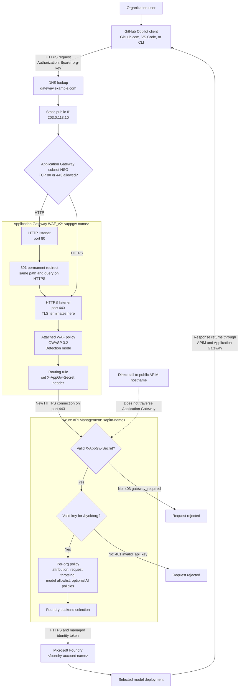

# Traffic flow and WAF placement

This document explains how a request travels through the deployed GitHub Copilot BYOK
gateway at `gateway.example.com`, what each Azure component does, and exactly where the
web application firewall (WAF) inspects traffic.

Hostnames, IP addresses, resource names, and organization identifiers below are examples or
placeholders. Replace `gateway.example.com` with your public DNS name, `203.0.113.10` with
your gateway's public IP, and angle-bracketed placeholders with your deployment values.

## The short version

A normal request follows this path:

1. A GitHub Copilot client calls `https://gateway.example.com/byok/<org>`.
2. DNS resolves that name to the Application Gateway public IP, `203.0.113.10`.
3. The subnet network security group (NSG) permits inbound TCP 443.
4. Application Gateway terminates the client TLS connection using the certificate for
   `gateway.example.com`.
5. The WAF, which is attached to Application Gateway, inspects the decrypted HTTP request.
6. Application Gateway sets a private `X-AppGw-Secret` header and opens a new HTTPS connection
   to Azure API Management (APIM).
7. APIM verifies both the gateway secret and the organization bearer key, then applies the
   per-organization policies.
8. APIM obtains a Microsoft Entra token through its managed identity and calls Microsoft
   Foundry over HTTPS.
9. The model response returns through APIM and Application Gateway to the client.

The WAF is **inside the Application Gateway request-processing path**. It is not a separate
network appliance before or after Application Gateway.

## Traffic-flow diagram

## Deployed components

| Layer | Deployed resource | Purpose |
| --- | --- | --- |
| Public name | `gateway.example.com` | Stable hostname used by clients |
| Public address | `203.0.113.10` | Static public IP attached to Application Gateway |
| Network filter | `<appgw-subnet-nsg-name>` | Allows public TCP 80/443 and required Azure gateway-management traffic |
| Front door | `<appgw-name>` | WAF_v2 Application Gateway, TLS termination, redirect, and APIM routing |
| TLS certificate | `appgw-ssl-cert` | Let's Encrypt certificate for `gateway.example.com` |
| WAF policy | `<appgw-name>-waf` | OWASP request inspection attached directly to Application Gateway |
| API gateway | `<apim-name>` | Gateway guard, org-key authorization, governance, and backend routing |
| Model host | `<foundry-account-name>` | Hosts the model deployments that APIM invokes |

All of these gateway-side resources are in resource group `<gateway-resource-group>`, except the Foundry
account, which is referenced in its own subscription and resource group.

## Where the WAF is

The WAF has two related Azure objects:

- **Application Gateway WAF_v2** is the data-plane service through which each client request
  passes.
- **`<appgw-name>-waf`** is the WAF policy resource containing the inspection settings
  and managed rules. The policy is associated directly with `<appgw-name>`.

The effective processing order is:

`TLS termination -> WAF inspection -> routing rule and header rewrite -> APIM backend`

TLS must terminate before WAF inspection because the WAF needs to inspect the HTTP method,
headers, path, query, and request body. Application Gateway then re-encrypts the request when it
connects to the APIM HTTPS backend. The WAF therefore does not cause the APIM hop to travel in
clear text.

The deployed WAF settings are:

| Setting | Current value | Meaning |
| --- | --- | --- |
| Policy state | Enabled | WAF inspection is active |
| Mode | Detection | Rule matches are detected, but the WAF does not block the request |
| Managed rules | OWASP 3.2 | Standard web-attack signatures such as SQL injection and XSS |
| Request body inspection | Enabled | The WAF can inspect request bodies, including prompt payloads |

Detection mode is intentional during initial rollout because programming prompts often contain
SQL, shell commands, scripts, or markup that resemble attacks. After reviewing representative
traffic and tuning exclusions, the policy can be changed to **Prevention** mode to block matching
requests.

WAF enforcement and WAF log retention are separate. Detection mode produces rule matches, but a
diagnostic setting must route `ApplicationGatewayFirewallLog` to Log Analytics or another sink if
the logs need to be retained and queried.

## One request, step by step

### 1. GitHub decides who can see the custom model

GitHub Enterprise BYOK model access is scoped to the selected GitHub organization. Organization access is
therefore enforced first by GitHub organization membership and the model's **Choose per
organization** setting.

This is an organization-level boundary, not individual Entra authentication at the gateway.
GitHub sends a shared organization key to APIM; APIM does not receive the human user's Entra
identity.

### 2. DNS points the client at Application Gateway

The `A` record for `gateway.example.com` resolves to `203.0.113.10`. DNS only tells the client
where to connect; the request does not pass through Azure DNS after resolution.

### 3. The subnet NSG admits the connection

Application Gateway runs in a dedicated subnet. Its attached NSG contains an inbound rule named
`AllowHttpHttpsInbound` that allows Internet TCP traffic on ports 80 and 443. It also retains the
Azure `GatewayManager` rule required to operate Application Gateway.

Without the 80/443 rule, the public IP can appear reachable at the TCP level while HTTP and TLS
requests reset before Application Gateway handles them. That was the cause of the connection
resets encountered during setup.

### 4. Port 80 redirects; port 443 handles the API request

The HTTP listener on port 80 no longer sends requests to APIM. It returns a permanent `301`
redirect to HTTPS while preserving the original path and query string.

The HTTPS listener on port 443 uses `appgw-ssl-cert`. The client validates that the certificate
matches `gateway.example.com`, and Application Gateway decrypts the request.

### 5. The WAF inspects the decrypted request

The attached OWASP 3.2 policy evaluates the request. In the current Detection mode, a rule match
does not stop the request. In Prevention mode, a non-excluded blocking rule would normally return
a WAF-generated error before APIM or Foundry sees the request.

The WAF is a web-attack filter. It does **not** decide whether the caller is a organization user, validate
the organization API key, enforce model access, or authenticate to Foundry.

### 6. Application Gateway routes to APIM

The `route-to-apim` rule sends accepted requests to backend host
`<apim-name>.azure-api.net` on HTTPS port 443. The backend health probe checks
`https://<apim-name>.azure-api.net/status-0123456789abcdef`; it was healthy during
validation.

Before forwarding, the `inject-appgw-secret` rewrite rule **sets** `X-AppGw-Secret` to a shared
secret. Setting rather than appending the header means a value supplied by an internet caller is
overwritten.

### 7. APIM proves the request traversed the WAF

APIM is still publicly addressable because GitHub's server-side BYOK caller must be able to reach
the gateway. The first APIM policy check compares `X-AppGw-Secret` with the protected APIM named
value.

- A request forwarded by Application Gateway has the expected secret and continues.
- A direct request to the APIM hostname normally lacks the secret and receives
  `403 gateway_required`.

This guard is what prevents a caller from skipping Application Gateway and therefore skipping the
WAF. The header value must remain secret; it is not a substitute for making APIM private.

### 8. APIM authorizes and governs the organization

The URL path selects the organization-specific API and policy. For example,
`/byok/<org>` selects that organization's policy. APIM then:

- validates `Authorization: Bearer <org-key>` against that path's secret named value;
- returns `401 invalid_api_key` when the key is missing or incorrect;
- records the organization for attribution;
- applies the per-org request rate limit;
- rejects a model outside the organization's allowlist with `403 model_not_allowed`;
- applies any enabled token, content-safety, cache, or telemetry policies; and
- selects the configured Foundry backend.

Changing only the URL to another organization's path does not transfer access. The caller must
also possess the key bound to that path.

### 9. APIM authenticates to Foundry

The client does not receive a Foundry key. APIM uses its system-assigned managed identity to
obtain a Microsoft Entra access token. The identity has the required Foundry role, and APIM calls
the selected model deployment over HTTPS.

### 10. The response returns on the reverse path

Foundry returns the model response to APIM. APIM applies applicable outbound policies, then sends
the response over HTTPS to Application Gateway. Application Gateway returns it over the original
client TLS session.

## The three encrypted connections

The route is encrypted in three independently established hops:

| Hop | Encryption and identity |
| --- | --- |
| Client to Application Gateway | HTTPS using the public certificate for `gateway.example.com` |
| Application Gateway to APIM | A new HTTPS connection using the APIM backend hostname |
| APIM to Foundry | HTTPS plus a Microsoft Entra token from the APIM managed identity |

Application Gateway terminates the first TLS connection so the WAF can inspect the request. It
does not simply pass the original encrypted bytes through to APIM.

## What was changed during HTTPS setup

1. Confirmed that `gateway.example.com` resolves to Application Gateway public IP
   `203.0.113.10`.
2. Proved control of the DNS name with the `_acme-challenge.gateway.example.com` DNS-01 TXT
   record.
3. Issued a Let's Encrypt full-chain PFX with Posh-ACME.
4. Uploaded the PFX to Application Gateway as `appgw-ssl-cert` without committing it or its
   password to the repository.
5. Added frontend port 443 and the `https-listener` bound to the certificate.
6. Moved the APIM backend routing rule to the HTTPS listener.
7. Changed the port 80 path into a permanent HTTP-to-HTTPS redirect.
8. Added the NSG rule permitting inbound TCP 80 and 443 while preserving the existing NSG
   association and Azure management rule.
9. Confirmed the `X-AppGw-Secret` rewrite was preserved.
10. Validated a `301` HTTP redirect, a successful TLS handshake, an expected unauthenticated
    HTTPS `401`, and a healthy APIM backend probe.

The certificate must cover your gateway hostname in its Subject Alternative Name. Record its
expiry date for renewal.

## Common failure points

| Symptom | Most likely layer |
| --- | --- |
| Name does not resolve | DNS `A` record |
| TCP connects but HTTP/TLS resets | Subnet NSG or listener configuration |
| Certificate-name or trust error | Application Gateway certificate or DNS hostname |
| WAF match appears but request succeeds | Expected while WAF is in Detection mode |
| WAF-generated rejection | WAF in Prevention mode or a blocking custom rule |
| `403 gateway_required` | Request went directly to APIM or gateway secret mismatch |
| `401 invalid_api_key` | Missing or incorrect organization bearer key |
| `403 model_not_allowed` | Model is outside the organization's APIM allowlist |
| `429` | Per-org request or token limit reached |
| `502` from Application Gateway | APIM backend unhealthy, probe failure, or backend TLS issue |

## Operational follow-up

- Renew and upload the certificate before its expiry date. The DNS-01 issuance process
  is manual unless DNS challenge automation is added.
- Rotate the organization key that appeared in terminal history during testing.
- Add an Application Gateway diagnostic setting if WAF and access logs are not already routed to
  a retained destination.
- Review real coding traffic in Detection mode, tune false positives, and only then consider
  changing the WAF to Prevention mode.
- Run an Azure deployment `what-if` before the next full Bicep deployment. The HTTPS setup used
  focused Application Gateway child-resource updates because the full module preview proposed
  removing the policy-managed subnet NSG association and changing unrelated resources.

For the parameterized design and optional AI policies, see the
[reference architecture](reference-architecture.md). For certificate deployment instructions,
see [getting started](getting-started.md#production-enable-https-on-the-app-gateway).