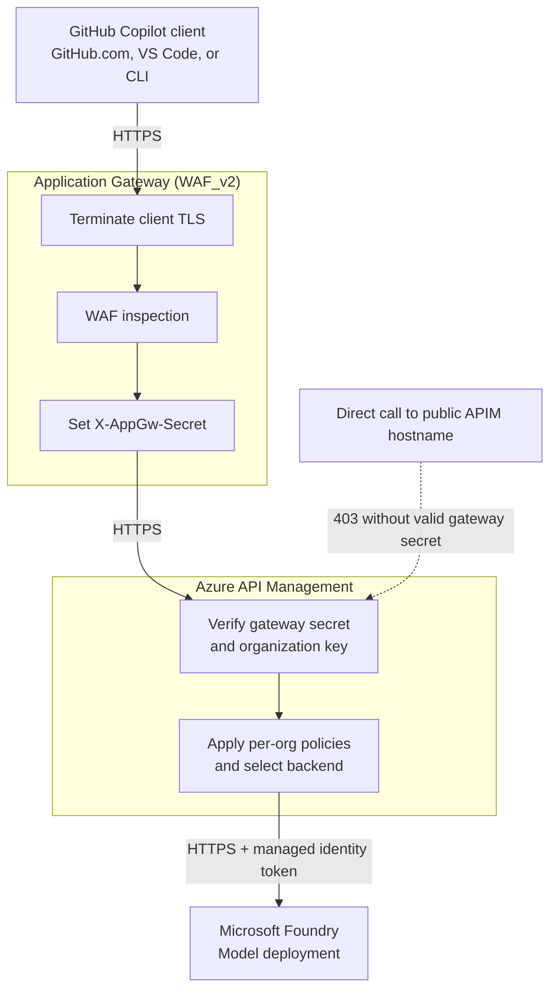

# Traffic flow and WAF placement

Copilot requests pass through Application Gateway and Azure API Management (APIM) to reach
Microsoft Foundry. The web application firewall (WAF) inspects requests **inside Application
Gateway**, after TLS termination.

Application Gateway is deployed by default. This guide assumes you have also supplied a TLS
certificate, which enables HTTPS automatically. Replace `gateway.example.com` with your public
hostname and `<org>` with your GitHub organization slug.

## Request path



1. **Connect.** Copilot calls `https://gateway.example.com/byok/<org>`. DNS resolves the hostname
   to Application Gateway's public IP; it is a lookup, not an HTTP hop. If the subnet has a
   network security group (NSG), it must allow inbound TCP 80/443 and required Azure
   gateway-management traffic.
2. **Terminate TLS.** The HTTPS listener on port 443 uses a certificate for the gateway hostname.
   Port 80 returns a `301` redirect to HTTPS, preserving the path and query. Configure clients
   with the HTTPS URL rather than relying on redirects.
3. **Inspect.** The attached WAF policy examines the decrypted request. The default Detection
   mode records rule matches without blocking requests.
4. **Forward.** Application Gateway sets `X-AppGw-Secret`, overwriting any client-supplied value,
   and opens a new HTTPS connection to `<apim-name>.azure-api.net` on port 443.
5. **Authorize and govern.** APIM checks the gateway secret, then the organization bearer key.
   It applies per-org attribution, request limits, and any configured model allowlist. Optional
   token, content-safety, caching, and telemetry policies are off by default.
6. **Call the model and return.** APIM obtains a Microsoft Entra token through its managed
   identity and calls Foundry over HTTPS. The identity needs the required Foundry role;
   clients never receive a Foundry key. The response passes through APIM's outbound policies
   and Application Gateway, then returns over the client's original TLS connection.

These are **three separate TLS connections**: client to Application Gateway, gateway to APIM,
and APIM to Foundry.

## Where the WAF is

The `<appgw-name>-waf` policy is attached to Application Gateway, not deployed as a separate
network hop. Requests follow this order:

`TLS termination -> WAF inspection -> routing and header rewrite -> APIM`

| Setting | Default value | Meaning |
| --- | --- | --- |
| Policy state | Enabled | WAF inspection is active |
| Mode | Detection | Records matches without blocking |
| Managed rules | OWASP 3.2 | Checks for web attacks such as SQL injection and XSS |
| Request body inspection | Enabled | Inspects request bodies, including prompts |

Programming prompts often contain SQL, shell commands, or markup that trigger web-attack rules.
Review representative traffic and tune exclusions before setting `appGwWafMode` to **Prevention**
to block matching requests.

To retain and query WAF matches, use an Application Gateway diagnostic setting to route
`ApplicationGatewayFirewallLog` to Log Analytics or another destination.

## Authentication boundaries

APIM checks two different secrets:

| Credential | Purpose |
| --- | --- |
| `X-AppGw-Secret`, checked against `appGwSecret` | Accept requests forwarded by Application Gateway |
| Organization bearer key, checked against `byokKey-<org>` | Authorize the organization selected by `/byok/<org>` |

The path alone grants no access: another organization's path requires that organization's key.
These checks are APIM policies, not WAF rules.

**APIM remains public by default.** The gateway-secret check rejects direct requests without
the correct secret; it is not network isolation. Keep the secret private.
With [`enablePrivateNetworking = true`](parameters.md#private-networking), the client entry
point remains public but the gateway connects to APIM's internal VIP, and APIM reaches
configured Foundry accounts through private endpoints and private DNS. Both key checks remain.

For enterprise BYOK, GitHub's **Access > Choose per organization** setting controls model
availability. APIM receives a shared organization key, not the user's Entra identity. This
solution does not provide per-user authentication at the gateway.

## Common failure points

| Symptom | Likely cause or check |
| --- | --- |
| Name does not resolve | Check the DNS `A` record |
| Connection resets | Check the subnet NSG and listener configuration |
| Certificate-name or trust error | Check the gateway certificate and hostname |
| WAF match appears but request succeeds | Expected in Detection mode |
| WAF-generated rejection | WAF in Prevention mode or a blocking custom rule |
| `403 gateway_required` | Direct APIM request or gateway secret mismatch |
| `401 invalid_api_key` | Missing or incorrect organization bearer key |
| `403 model_not_allowed` | Model is outside the organization's APIM allowlist |
| `429` | Per-org request or token rate limit reached |
| `502` from Application Gateway | APIM backend unhealthy, probe failure, or backend TLS issue |
| `400` says `max_tokens` is unsupported | Deploy the current chat operation policy; it normalizes the legacy limit for the Foundry OpenAI API without a model-name list |

The APIM health probe checks
`https://<apim-name>.azure-api.net/status-0123456789abcdef`.

## Chat request parameter compatibility

For the Foundry OpenAI backend, the chat operation automatically translates the deprecated
`max_tokens` field to `max_completion_tokens`. This is an API-contract rule, not a list of
model names, so new chat deployments and custom deployment aliases need no additional
configuration. The numeric limit is unchanged. If a client supplies both fields, an
explicit non-null `max_completion_tokens` takes precedence and `max_tokens` is removed.
Requests with neither field receive no invented limit.

Alternate Cohere and managed-compute backends retain their existing request contract,
selected by the existing organization-to-backend routing rather than model IDs.
The Responses API remains separate and uses its own `max_output_tokens` field.
Do not rewrite an embedding request into chat: embedding-only models cannot provide
Copilot's required chat, tool calling, and streaming capabilities.

## Healthy backend but public connections fail

`Running` with a `Healthy` APIM backend proves neither public listener access nor successful
inference. The gateway can reach APIM while its subnet NSG rejects incoming clients.
Starting a stopped gateway does not restore client-port rules changed by another controller.
A populated model picker is also insufficient: model discovery and inference are separate,
and clients can display configured or previously discovered models without a successful prompt.

### 1. Check state and backend health

Run these read-only commands in PowerShell from the repository root. Use the gateway's
subscription and resource group, not necessarily the Foundry account's:

```powershell
$subscriptionId = '<gateway-subscription-id>'
$resourceGroup = '<gateway-resource-group>'
$gatewayName = '<appgw-name>'

az network application-gateway show `
  --subscription $subscriptionId --resource-group $resourceGroup --name $gatewayName `
  --query "{operationalState:operationalState,provisioningState:provisioningState}"

az network application-gateway show-backend-health `
  --subscription $subscriptionId --resource-group $resourceGroup --name $gatewayName
```

Expect `Running`, `Succeeded`, and backend server health `Healthy`. If backend health fails,
resolve its probe diagnostic first. If it is healthy, check DNS, certificate validity and
hostname, and public HTTPS separately; do not skip directly to changing model configuration.

### 2. Inspect the attached NSG

```powershell
$subnetId = az network application-gateway show `
  --subscription $subscriptionId --resource-group $resourceGroup --name $gatewayName `
  --query "gatewayIPConfigurations[0].subnet.id" --output tsv
if ($LASTEXITCODE -ne 0) { throw 'Could not read the gateway subnet ID.' }

$subnetJson = az network vnet subnet show --subscription $subscriptionId --ids $subnetId `
  --query "{addressPrefix:addressPrefix,nsgId:networkSecurityGroup.id}" --output json
if ($LASTEXITCODE -ne 0) { throw 'Could not read the gateway subnet.' }
$subnet = $subnetJson | ConvertFrom-Json
if ([string]::IsNullOrWhiteSpace($subnet.nsgId)) {
    throw 'No NSG is attached. Investigate the listener, DNS, TLS, and network path before applying an existing-NSG repair.'
}

$nsgJson = az network nsg show --subscription $subscriptionId --ids $subnet.nsgId --output json
if ($LASTEXITCODE -ne 0) { throw 'Could not read the attached NSG.' }
$nsg = $nsgJson | ConvertFrom-Json
$nsg.securityRules | Select-Object name,priority,direction,access,protocol,
  sourceAddressPrefix,destinationAddressPrefix,destinationPortRange,destinationPortRanges
```

For an HTTPS-enabled gateway, verify these allowances:

| Traffic | Source | Destination | TCP destination ports |
| --- | --- | --- | --- |
| Public clients | `Internet` | Gateway subnet prefix | `443` and `80` for the redirect |
| Gateway management | `GatewayManager` | Any | `65200-65535` |
| Platform load-balancer probes | `AzureLoadBalancer` | As provided by the default rule | Retain the default allowance |

The default `DenyAllInBound` blocks public clients if no earlier rule allows their listener
ports. A GatewayManager-only custom rule can therefore coexist with healthy backend probes
and completely unavailable public HTTPS. Also inspect earlier deny rules; adding an allow
at priority 1000 does not override a higher-priority deny.

### 3. Preview and apply an approved, child-rule-only repair

Confirm the NSG owner permits these ports and that governance automation will retain the
approved rule. Check its activity history to identify configuration writers. Do not detach
the NSG, disable policy, or install an automatic repair loop to fight governance.

Inspect existing names and inbound priorities. This module reserves
`AllowByokClientIngress` at priority 1000. Stop if that name belongs to another owner or the
priority conflicts. Existing management/default rules are deliberately not changed; resolve
any missing infrastructure allowances with the owner.

Save a non-secret baseline of rules and associations outside the repository for rollback.
The following example is for an existing NSG **in the gateway's resource group** and a
gateway whose HTTPS listener is already configured:

```powershell
$nsgParameters = @(
  "nsgName=$($nsg.name)"
  'reuseExisting=true'
  'enableHttps=true'
  "subnetAddressPrefix=$($subnet.addressPrefix)"
)

az deployment group validate `
  --subscription $subscriptionId --resource-group $resourceGroup `
  --template-file .\infra\modules\app-gateway-nsg.bicep --parameters $nsgParameters

az deployment group what-if `
  --subscription $subscriptionId --resource-group $resourceGroup --mode Incremental `
  --template-file .\infra\modules\app-gateway-nsg.bicep --parameters $nsgParameters
```

Continue only when validation succeeds and the preview changes just the intended client rule:
no NSG parent update/replacement, subnet reassociation, unrelated rule changes, or deletions.
Then apply the same module:

```powershell
az deployment group create `
  --subscription $subscriptionId --resource-group $resourceGroup --mode Incremental `
  --name byok-gateway-ingress `
  --template-file .\infra\modules\app-gateway-nsg.bicep --parameters $nsgParameters
```

Persist the existing NSG name in your private deployment parameter file before any future
full deployment:

```bicep
param appGwExistingNsgName = '<attached-nsg-name>'
```

An empty value instead selects the repository-owned `<appGwName>-nsg` and its complete
custom rule collection. Preview the full template with the existing-NSG selection:

```powershell
az deployment group what-if `
  --subscription $subscriptionId --resource-group $resourceGroup --mode Incremental `
  --template-file .\infra\main.bicep --parameters .\infra\my.bicepparam
```

Do not apply a broad redeployment just to repair ingress. Stop on unexpected NSG association,
subnet, certificate, or application changes. Inspect resolved what-if output privately;
do not post keys, gateway secrets, or certificate data. Only remove a newly added application
rule to roll back, or restore that child rule's saved prior definition if it was updated.
Never overwrite the whole NSG from an old snapshot over concurrent governance changes.

### 4. Verify the actual client path

- HTTP should redirect to the HTTPS hostname, preserving path and query. Test without keys;
  never send credentials over HTTP or bypass certificate validation.
- HTTPS to `https://<gateway-host>/byok/<org>/models` without a key should return
  `401 invalid_api_key`, not a connection reset. A direct APIM call without the gateway
  secret should still return `403 gateway_required`.
- Run [authenticated discovery and inference checks](getting-started.md#step-5--verify-the-proxy).
  A model-list response must include the intended deployment, and a prompt must return a
  non-empty assistant response. Verify streaming completes using the configured API type.
- Retry a prompt with the original Copilot client and selected BYOK model. Do not treat
  a populated picker, a different model, or backend health alone as recovery.
- Compare rules and associations with the baseline and repeat what-if to check idempotence.
  Confirm governance retention; a successful deployment does not prove another controller
  cannot remove the rule later.

Use a local secure credential prompt rather than sharing keys in chat or logs. Keep any
unverified inference, streaming, client, or governance checks explicitly outstanding.
Do not stop a running gateway merely to test recovery. Repeat these checks after its next
approved lifecycle operation; a deliberate stop/start requires an approved outage.

### 5. Direct inference works but Copilot still reports no response

If authenticated inference and streaming succeed outside Copilot, inspect the client's
diagnostic output before changing Azure again. The generic
`No response was returned. Send your message again to retry.` message does not identify
a network failure on its own.

For example, this warning identifies a client context-budget failure:

> Static system messages and tool definitions exceed the model's usable context budget.
> Reduce static context or switch to a larger-context model.

Reduce unnecessary enabled MCP tools/servers and instructions for that chat, or select
a model with sufficient context for the agent workload. Starting a new chat alone does
not reduce fixed instructions or tool definitions. Check the custom model's declared
prompt/output limits against the actual provider limits; do not inflate the declared
context window beyond what the model supports.

A picker display name can differ from the Foundry deployment ID. Verify the mapping
rather than sending the display name as the API's `model`. Successful discovery still
does not establish that the client's full tool-enabled request fits the model.

For an Insiders CLI-backed Agent Host failure, a comparison with standard local Copilot
Chat can distinguish the client engine from the enterprise model registration. See
[Insiders client-engine verification](client-surfaces.md#insiders-client-engine-verification).
This comparison changes no model limits or Azure configuration.

## Operational follow-up

- Renew and upload the gateway certificate before it expires. Plan for manual renewal if DNS-01
  challenges are not automated.
- Keep certificates, passwords, gateway secrets, and organization keys out of source control.
  Rotate any exposed credentials.
- Retain Application Gateway access and firewall logs for troubleshooting.
- Preview deployments with `az deployment group what-if`. Check for unintended changes,
  especially to subnet NSG associations and gateway-management rules.

For setup, see [Enable HTTPS](getting-started.md#production-enable-https-on-the-app-gateway).
For design details and optional AI policies, see the [reference architecture](reference-architecture.md).
