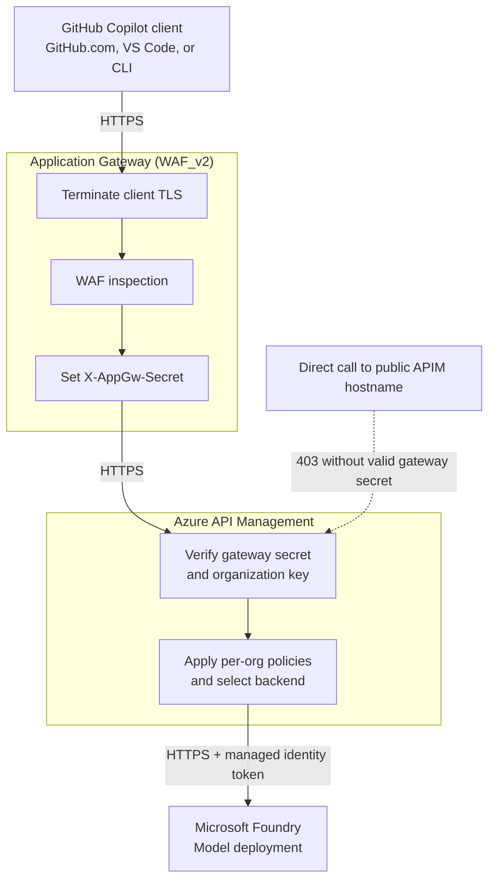

# Traffic flow and WAF placement

Copilot requests pass through Application Gateway and Azure API Management (APIM) to reach
Microsoft Foundry. The web application firewall (WAF) inspects requests **inside Application
Gateway**, after TLS termination.

Application Gateway is deployed by default. This guide assumes you have also supplied a TLS
certificate, which enables HTTPS automatically. Replace `gateway.example.com` with your public
hostname and `<org>` with your GitHub organization slug.

## Request path

1. **Connect.** Copilot calls `https://gateway.example.com/byok/<org>`. DNS resolves the hostname
   to Application Gateway's public IP; it is a lookup, not an HTTP hop. If the subnet has a
   network security group (NSG), it must allow inbound TCP 80/443 and required Azure
   gateway-management traffic.
2. **Terminate TLS.** The HTTPS listener on port 443 uses a certificate for the gateway hostname.
   Port 80 returns a `301` redirect to HTTPS, preserving the path and query. Configure clients
   with the HTTPS URL rather than relying on redirects.
3. **Inspect.** The attached WAF policy examines the decrypted request. The default Detection
   mode records rule matches without blocking requests.
4. **Forward.** Application Gateway sets `X-AppGw-Secret`, overwriting any client-supplied value,
   and opens a new HTTPS connection to `<apim-name>.azure-api.net` on port 443.
5. **Authorize and govern.** APIM checks the gateway secret, then the organization bearer key.
   It applies per-org attribution, request limits, and any configured model allowlist. Optional
   token, content-safety, caching, and telemetry policies are off by default.
6. **Call the model and return.** APIM obtains a Microsoft Entra token through its managed
   identity and calls Foundry over HTTPS. The identity needs the required Foundry role;
   clients never receive a Foundry key. The response passes through APIM's outbound policies
   and Application Gateway, then returns over the client's original TLS connection.

These are **three separate TLS connections**: client to Application Gateway, gateway to APIM,
and APIM to Foundry.

## Where the WAF is

The `<appgw-name>-waf` policy is attached to Application Gateway, not deployed as a separate
network hop. Requests follow this order:

`TLS termination -> WAF inspection -> routing and header rewrite -> APIM`

| Setting | Default value | Meaning |
| --- | --- | --- |
| Policy state | Enabled | WAF inspection is active |
| Mode | Detection | Records matches without blocking |
| Managed rules | OWASP 3.2 | Checks for web attacks such as SQL injection and XSS |
| Request body inspection | Enabled | Inspects request bodies, including prompts |

Programming prompts often contain SQL, shell commands, or markup that trigger web-attack rules.
Review representative traffic and tune exclusions before setting `appGwWafMode` to **Prevention**
to block matching requests.

To retain and query WAF matches, use an Application Gateway diagnostic setting to route
`ApplicationGatewayFirewallLog` to Log Analytics or another destination.

## Authentication boundaries

APIM checks two different secrets:

| Credential | Purpose |
| --- | --- |
| `X-AppGw-Secret`, checked against `appGwSecret` | Accept requests forwarded by Application Gateway |
| Organization bearer key, checked against `byokKey-<org>` | Authorize the organization selected by `/byok/<org>` |

The path alone grants no access: another organization's path requires that organization's key.
These checks are APIM policies, not WAF rules.

**APIM remains public.** The gateway-secret check rejects direct requests without the correct
secret; it is not network isolation. Keep the secret private.

For enterprise BYOK, GitHub's **Access > Choose per organization** setting controls model
availability. APIM receives a shared organization key, not the user's Entra identity. This
solution does not provide per-user authentication at the gateway.

## Common failure points

| Symptom | Likely cause or check |
| --- | --- |
| Name does not resolve | Check the DNS `A` record |
| Connection resets | Check the subnet NSG and listener configuration |
| Certificate-name or trust error | Check the gateway certificate and hostname |
| WAF match appears but request succeeds | Expected in Detection mode |
| WAF-generated rejection | WAF in Prevention mode or a blocking custom rule |
| `403 gateway_required` | Direct APIM request or gateway secret mismatch |
| `401 invalid_api_key` | Missing or incorrect organization bearer key |
| `403 model_not_allowed` | Model is outside the organization's APIM allowlist |
| `429` | Per-org request or token rate limit reached |
| `502` from Application Gateway | APIM backend unhealthy, probe failure, or backend TLS issue |

The APIM health probe checks
`https://<apim-name>.azure-api.net/status-0123456789abcdef`.

## Operational follow-up

- Renew and upload the gateway certificate before it expires. Plan for manual renewal if DNS-01
  challenges are not automated.
- Keep certificates, passwords, gateway secrets, and organization keys out of source control.
  Rotate any exposed credentials.
- Retain Application Gateway access and firewall logs for troubleshooting.
- Preview deployments with `az deployment group what-if`. Check for unintended changes,
  especially to subnet NSG associations and gateway-management rules.

For setup, see [Enable HTTPS](getting-started.md#production-enable-https-on-the-app-gateway).
For design details and optional AI policies, see the [reference architecture](reference-architecture.md).
